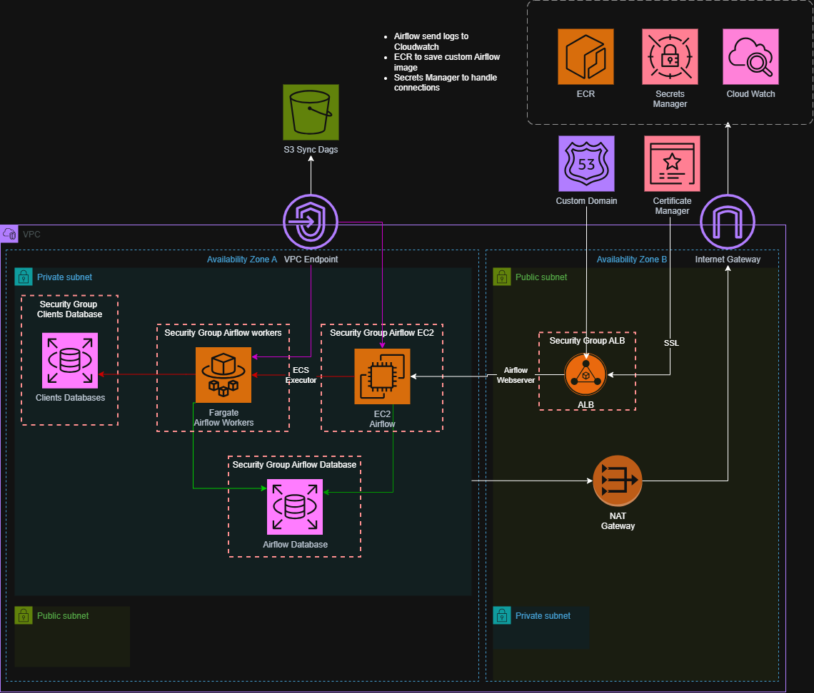

# AWS Apache Airflow Hybrid Blueprint (V5)

[](https://www.terraform.io/)
[](https://registry.terraform.io/providers/hashicorp/aws/latest)
[](https://airflow.apache.org/)
[](https://aws.amazon.com/fargate/)
[](docs/decisions.md)
[](LICENSE)

An enterprise-grade, production-ready reference blueprint for a resilient, distributed data orchestration platform on AWS. Built with strict modular Terraform, this architecture combines a private control plane on Amazon EC2 with serverless, on-demand task compute on **AWS ECS Fargate** via **`AwsEcsExecutor`**, eliminating idle worker costs and traditional Celery/Redis broker infrastructure.

---

## Architecture Overview

```
                                [ Public Internet ]
                                         |
                                         v (HTTPS :443)
                  +----------------------------------------------+
                  |  Application Load Balancer (Public Subnets)  |
                  +----------------------+-----------------------+
                                         | (HTTP :8080 - Encrypted Transit)
                                         v
+-----------------------------------------------------------------------------------+
| Multi-AZ VPC (10.0.0.0/16)                                                         |
|                                                                                   |
|  [Availability Zone A]                      [Availability Zone B]                 |
|  +-------------------------------------+    +----------------------------------+  |
|  | Private Subnet 1 (10.0.10.0/24)     |    | Private Subnet 2 (10.0.20.0/24)  |  |
|  |                                     |    |                                  |  |
|  | +---------------------------------+ |    | +------------------------------+ |  |
|  | | Airflow Core EC2                | |    | | Ephemeral Fargate Workers    | |  |
|  | | * Webserver (:8080)             | |    | | * Spawned on-demand via      | |  |
|  | | * Scheduler (AwsEcsExecutor)    | |    | |   ecs:RunTask                | |  |
|  | | * Background S3 DAG Sync        | |    | | * Zero idle compute ($0.00)  | |  |
|  | | * Zero SSH (SSM Session Manager)| |    | | * Isolated per task          | |  |
|  | +----------------+----------------+ |    | +--------------+---------------+ |  |
|  +------------------|------------------+    +----------------|-----------------+  |
|                     |                                        |                    |
|                     +-------------------+--------------------+                    |
|                                         | (:5432)                                 |
|                                         v                                         |
|                     +---------------------------------------+                     |
|                     | Amazon RDS PostgreSQL (Multi-AZ)      |                     |
|                     | * Airflow Metadata Store              |                     |
|                     +---------------------------------------+                     |
+-----------------------------------------------------------------------------------+
       |                                                    |
       v (Free $0.00 Gateway Endpoint)                      v (NAT Gateway Egress Trunk)
+----------------------------------+               +--------------------------------+
| Amazon S3 DAGs Bucket            |               | AWS Regional Services:         |
| * Versioned, Encrypted (SSE-S3)  |               | * Amazon ECR (Worker Images)   |
| * Total Public Access Block      |               | * AWS Secrets Manager          |
+----------------------------------+               | * Amazon CloudWatch Logs       |
                                                   | * AWS Systems Manager (SSM)    |
                                                   +--------------------------------+
```



---

## Key Value Propositions & Engineering Highlights

| Feature | Production Advantage | Architectural Impact |
|---|---|---|
| **Elastic Fargate Workers** | **Zero Idle Compute Cost ($0.00 at rest)** | Completely replaces persistent Celery worker fleets and Redis/RabbitMQ brokers with on-demand ECS Fargate tasks via `AwsEcsExecutor`. |
| **Hybrid FinOps Routing** | **~$65/mo. ($780/yr.) baseline savings** | Routes heavy DAG syncs and ECR image layers over a **free S3 VPC Gateway Endpoint**, utilizing 1 NAT Gateway for remaining egress APIs. |
| **Local Disk DagBag Parsing** | **Eliminates EFS IOPS bottlenecks** | Continuous background S3 synchronization (`aws s3 sync`) to local storage guarantees microsecond DagBag parsing times without NFS latency. |
| **Zero-Trust Access Control** | **Port 22 & Bastions 100% Eliminated** | Administrative access is strictly brokered through **AWS Systems Manager (SSM Session Manager)**; CI/CD deploys via **IAM OIDC** federation. |
| **Multi-AZ Fault Tolerance** | **Zero Single-Point-of-Failure (SPOF)** | Symmetrical deployment across 2 Availability Zones for VPC subnets, Application Load Balancer interfaces, and Amazon RDS PostgreSQL. |

---

## Repository Structure

```text
.
├── .github/
│   └── workflows/
│       └── deploy.yml              # CI/CD pipeline via IAM OIDC (S3 DAG sync & ECR build)
├── dags/
│   └── example_etl_ecs.py          # Production ETL DAG with dynamic CPU/RAM executor_config
├── docker/
│   └── airflow-worker/
│       ├── Dockerfile              # Multi-stage non-root container with AWS CLI & providers
│       └── entrypoint.sh           # S3 cold-sync script before airflow tasks run execution
├── docs/
│   ├── architecture.md             # In-depth architectural specification and network matrix
│   ├── decisions.md                # Formal Architecture Decision Records (ADR 01 to 04)
│   ├── troubleshooting.md          # Comprehensive Runbook for incident response & diagnostics
│   └── AWSAirflowArchitectureDiagram.png # Visual system architecture topology
├── terraform/
│   ├── modules/
│   │   ├── alb-route53/            # Public ALB, HTTPS/ACM listener, HTTP->HTTPS redirect
│   │   ├── ec2-airflow/            # Private Airflow Core EC2, SSM, systemd S3 sync & daemon
│   │   ├── ecs-fargate/            # Clúster ECS, ECR repo, CloudWatch logs & task definition
│   │   ├── iam-oidc/               # GitHub Actions OIDC Provider + EC2/ECS IAM roles
│   │   ├── rds/                    # Multi-AZ Amazon RDS PostgreSQL metadata store
│   │   ├── s3-dags/                # Private encrypted S3 bucket for Airflow DAGs
│   │   ├── security-groups/        # Micro-segmented security groups & chained rules
│   │   └── vpc/                    # Multi-AZ VPC, subnets, IGW, NAT GW, S3 Gateway Endpoint
│   ├── main.tf                     # Master root orchestration file
│   ├── variables.tf                # Parameterized variables with explicit validation blocks
│   ├── outputs.tf                  # Consolidated outputs (ALB DNS, S3 Bucket, Role ARNs)
│   ├── versions.tf                 # Terraform >= 1.5.0, AWS Provider ~> 5.0
│   └── terraform.tfvars.example    # Configuration template for environment deployments
├── .gitignore                      # Enforces exclusion of state, secrets, and local context
├── LICENSE                         # MIT License
└── README.md                       # Main portfolio documentation
```

---

## Quickstart Deployment Guide

### Prerequisites
1. [Terraform](https://developer.hashicorp.com/terraform/downloads) $\ge$ 1.5.0
2. [AWS CLI](https://aws.amazon.com/cli/) $\ge$ 2.0 configured with administrative credentials
3. [Docker](https://www.docker.com/) for building worker images locally or via CI/CD

### 1. Clone & Configure
```bash
git clone https://github.com/hilixops/aws-ecs-fargate-production-blueprint.git
cd aws-ecs-fargate-production-blueprint/terraform

# Create environment configuration from template
cp terraform.tfvars.example terraform.tfvars
```

Edit `terraform.tfvars` with your specific parameters:
```hcl
aws_region   = "us-east-1"
environment  = "production"
project_name = "airflow-blueprint"

# Set a secure master password for the PostgreSQL metadata store
db_password  = "YourSuperSecurePassword123!"

# Optional: Custom domain for HTTPS Web UI (leave null to use ALB DNS directly)
domain_name     = null
route53_zone_id = null
```

### 2. Initialize & Validate
```bash
terraform init
terraform fmt -recursive
terraform validate
```

### 3. Provision Infrastructure
```bash
terraform plan -out=tfplan
terraform apply tfplan
```

### 4. Post-Provisioning Outputs
Upon successful deployment, Terraform outputs critical operational endpoints:
```bash
Apply complete! Resources: 38 added, 0 changed, 0 destroyed.

Outputs:
alb_dns_name            = "airflo-alb-123456789.us-east-1.elb.amazonaws.com"
dags_bucket_name        = "airflow-blueprint-production-dags-xxxxxx"
ecr_repository_url      = "123456789012.dkr.ecr.us-east-1.amazonaws.com/airflow-worker"
github_actions_role_arn = "arn:aws:iam::123456789012:role/airflow-blueprint-production-github-actions-role"
ec2_instance_id         = "i-0abcdef1234567890"
rds_endpoint            = "airflow-blueprint-production-rds-xxxx.us-east-1.rds.amazonaws.com:5432"
```

---

## Zero-Trust Administration (AWS SSM)

Because TCP port 22 is strictly disabled, connect to the Airflow Core EC2 instance using **AWS Systems Manager**:

```bash
# Start an interactive shell session without SSH keys
aws ssm start-session --target <ec2_instance_id>

# Switch to the airflow system user to inspect daemons
sudo su - airflow
systemctl status airflow-webserver.service
systemctl status airflow-scheduler.service
systemctl status airflow-dag-sync.timer
```

---

## Continuous Deployment Workflow (GitHub Actions OIDC)

This repository includes a production-grade GitHub Actions workflow (`.github/workflows/deploy.yml`) that executes without static AWS credentials:

1. In GitHub Repository Settings, navigate to **Secrets and variables > Actions**.
2. Add the following variables/secrets:
   - `AWS_ROLE_ARN`: Set to `github_actions_role_arn` output.
   - `DAGS_S3_BUCKET`: Set to `dags_bucket_name` output.
   - `AWS_REGION`: Set to `us-east-1` (or your target region).
3. Any push to `main` modifying `dags/**` automatically triggers an incremental S3 sync.
4. Any push modifying `docker/**` automatically builds and pushes the updated multi-stage worker container to Amazon ECR.

---

## Architecture Decision Records & Operational Runbooks

- [Architecture Specification (`docs/architecture.md`)](docs/architecture.md): Deep-dive into network routing, security group chaining, and ECS task lifecycle.
- [Architecture Decision Records (`docs/decisions.md`)](docs/decisions.md):
  - **ADR-01:** `AwsEcsExecutor` on Fargate vs. `CeleryExecutor` with Redis.
  - **ADR-02:** S3 DAG Sync & Gateway Endpoint vs. Amazon EFS.
  - **ADR-03:** 1 NAT Gateway + S3 Gateway Endpoint vs. PrivateLink Mesh (FinOps).
  - **ADR-04:** Zero-Trust Access via SSM Session Manager and IAM OIDC.
- [Troubleshooting Runbook (`docs/troubleshooting.md`)](docs/troubleshooting.md): Operational procedures for OOMKilled tasks (Exit 137), zombie states, ECR pull timeouts, and database connection limits.

---

## Author & Governance
- **Maintainer:** [Hilixops](https://github.com/hilixops)
- **License:** Released under the [MIT License](LICENSE).
