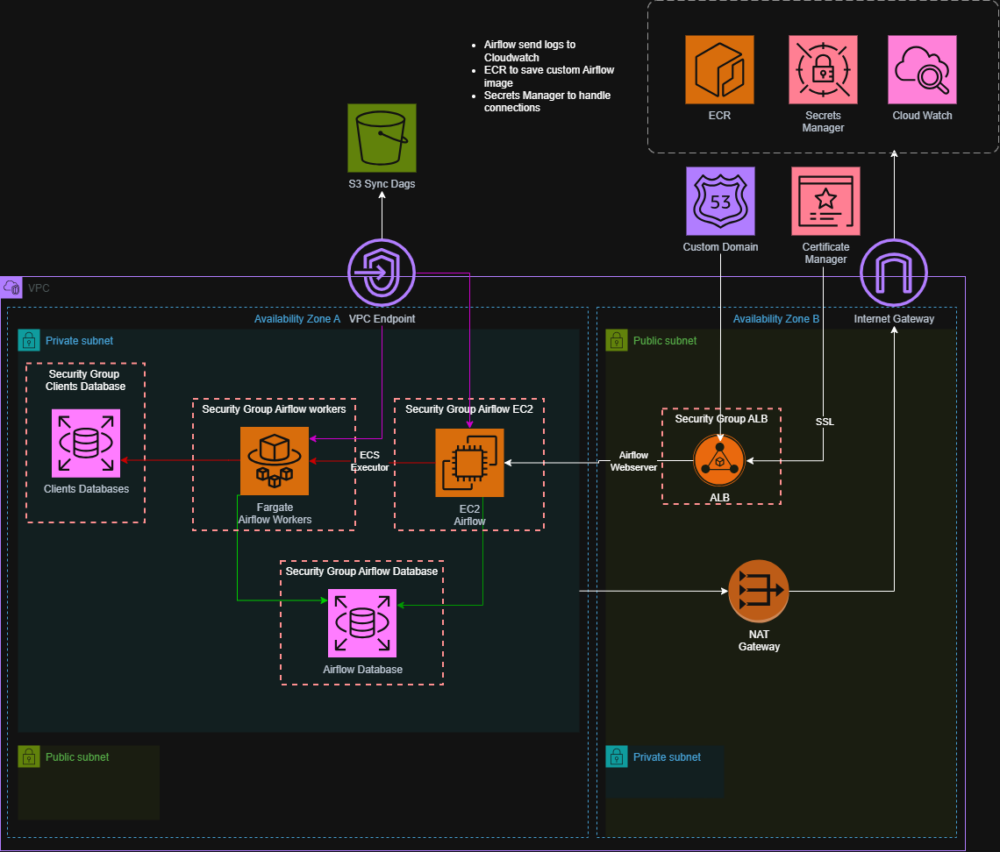

# Reference Architecture: AWS Apache Airflow Hybrid Blueprint (V5)

## 1. Executive Summary

This reference blueprint provisions an enterprise-grade, distributed data orchestration platform powered by **Apache Airflow 2.9+** on Amazon Web Services (AWS). Engineered under strict Infrastructure as Code (IaC) principles with Terraform, it combines a dedicated private control plane with serverless, elastic task execution via **AWS ECS Fargate** using `AwsEcsExecutor`.

```
               +-----------------------------------------------------------+
               |                  Custom Domain (Route 53)                 |
               +-----------------------------+-----------------------------+
                                             |
                                             v (HTTPS :443)
               +-----------------------------------------------------------+
               |          AWS Certificate Manager (ACM TLS Cert)           |
               +-----------------------------+-----------------------------+
                                             |
                                             v
               +-----------------------------------------------------------+
               |         Public Application Load Balancer (ALB)            |
               |                 [Security Group: sg_alb]                  |
               +-----------------------------+-----------------------------+
                                             |
                                             | (HTTP :8080 - Encrypted VPC Transit)
                                             v
+-----------------------------------------------------------------------------------------+
|                                    VPC (10.0.0.0/16)                                    |
|                                                                                         |
|  +-------------------------------------+   +-----------------------------------------+  |
|  |     Availability Zone A             |   |        Availability Zone B              |  |
|  |                                     |   |                                         |  |
|  |  [Public Subnet 1: 10.0.1.0/24]     |   |  [Public Subnet 2: 10.0.2.0/24]         |  |
|  |  * ALB Ingress Interface            |   |  * ALB Ingress Interface                |  |
|  |  * NAT Gateway + Elastic IP         |   |                                         |  |
|  +-------------------------------------+   +-----------------------------------------+  |
|                    |                                             |                      |
|  ==================|=============================================|====================  |
|                    v (Private Egress Trunk)                      v                      |
|  +-------------------------------------+   +-----------------------------------------+  |
|  |  [Private Subnet 1: 10.0.10.0/24]   |   |  [Private Subnet 2: 10.0.20.0/24]       |  |
|  |                                     |   |                                         |  |
|  |  +-------------------------------+  |   |  +-----------------------------------+  |  |
|  |  | Airflow Core EC2 (Private)    |  |   |  | Ephemeral ECS Fargate Workers     |  |  |
|  |  | * Webserver (:8080)           |  |   |  | * Spawned per Task on-demand      |  |  |
|  |  | * Scheduler (AwsEcsExecutor)  |  |   |  | * Dynamic CPU & Memory allocation |  |  |
|  |  | * Background S3 DAG Sync      |  |   |  | * S3 Sync Entrypoint              |  |  |
|  |  | [SG: sg_airflow_ec2]          |  |   |  | [SG: sg_airflow_workers]          |  |  |
|  |  +---------------+---------------+  |   |  +-----------------+-----------------+  |  |
|  |                  |                  |   |                    |                    |  |
|  |                  +------------+     |   |     +--------------+                    |  |
|  |                               |     |   |     |                                   |  |
|  |                               v     v   v     v                                   |  |
|  |                     +---------------------------------------+                     |  |
|  |                     | Amazon RDS PostgreSQL (Multi-AZ DB SG)|                     |  |
|  |                     | * Airflow Metadata Store (:5432)      |                     |  |
|  |                     | [SG: sg_airflow_db]                   |                     |  |
|  |                     +---------------------------------------+                     |  |
|  +-----------------------------------------------------------------------------------+  |
+-----------------------------------------------------------------------------------------+
       |                                                            |
       v ($0.00 Zero-Cost S3 Gateway Endpoint)                      v (NAT Gateway Egress)
+------------------------------------+                      +-----------------------------+
| Amazon S3 DAGs Bucket              |                      | AWS Regional Services:      |
| * Versioned, Encrypted (SSE-S3)    |                      | * Amazon ECR (Images)       |
| * Total Public Access Block        |                      | * AWS Secrets Manager       |
+------------------------------------+                      | * CloudWatch Logs           |
                                                            | * AWS Systems Manager (SSM) |
                                                            +-----------------------------+
```



---

## 2. High-Availability Network Topology

The network design strictly follows AWS Well-Architected Reliability and Security pillars:

### Multi-AZ Subnet Allocation
- **2 Availability Zones (`AZ-a` and `AZ-b`):** Guarantees zero single-point-of-failure (SPOF) for networking, compute, and relational databases.
- **Public Subnets (2):**
  - Host the Internet Gateway (`IGW`) routing table.
  - Accommodate the external Application Load Balancer interfaces across both zones.
  - Host 1 Elastic IP and 1 NAT Gateway deployed in `AZ-a` to broker outbound connections.
- **Private Subnets (2):**
  - Strictly isolated without public IPv4 addressing (`map_public_ip_on_launch = false`).
  - Accommodate Airflow Core (EC2), ephemeral ECS Fargate task elastic network interfaces (ENIs), and the Amazon RDS PostgreSQL Multi-AZ DB Subnet Group.

### Traffic Flow and Routing Architecture
1. **Ingress HTTPS Path:**
   `Route 53` $\rightarrow$ `ACM TLS Certificate` $\rightarrow$ `ALB (HTTPS :443)` $\rightarrow$ `Target Group (HTTP :8080)` $\rightarrow$ `Airflow Core EC2 Webserver`.
   *HTTP port 80 traffic is permanently redirected to HTTPS 443 with status code 301.*
2. **Private S3 Gateway Endpoint Route ($0.00 FinOps):**
   Continuous DAG file synchronizations (`aws s3 sync`) from both the EC2 Scheduler and Fargate workers route entirely across AWS's internal network backbone via an **Amazon S3 VPC Gateway Endpoint**, completely bypassing NAT Gateway data transfer rates.
3. **Egress Trunk Route (NAT Gateway):**
   Outbound traffic destined for AWS service endpoints (Amazon ECR image pulls, AWS Secrets Manager credentials, AWS CloudWatch logs, AWS Systems Manager) and external business APIs routes securely through the single NAT Gateway in public subnet 1.

---

## 3. Micro-Segmentation & Security Group Matrix

Communication between layers is governed by strictly chained security group references. Direct IP CIDR access is forbidden within the private boundary.

| Security Group ID | Role | Inbound Rules | Outbound Rules | Security Rationale |
|---|---|---|---|---|
| `sg_alb` | Ingress Gateway | `0.0.0.0/0` on ports `80`, `443` | `sg_airflow_ec2` on port `8080` | Shields internal compute; terminates TLS. |
| `sg_airflow_ec2` | Control Plane | `sg_alb` on port `8080` | `sg_airflow_db` on `5432`, `0.0.0.0/0` on `443`, `53` | Zero SSH (port 22 eliminated); managed solely via SSM. |
| `sg_airflow_workers` | Ephemeral Compute | **None (Zero Ingress)** | `sg_airflow_db` on `5432`, `sg_clients_db` on engine port, `0.0.0.0/0` on `443`, `80`, `53` | Workers only make outbound requests to DBs, APIs, and S3. |
| `sg_airflow_db` | Metadata Store | `sg_airflow_ec2`, `sg_airflow_workers` on port `5432` | **None** | Database is isolated from internet and non-Airflow subnets. |
| `sg_clients_db` | Business Data | `sg_airflow_workers` on configured engine port | **None** | Business workloads are only accessible by ETL tasks. |

---

## 4. Compute & Execution Lifecycle: `AwsEcsExecutor`

Unlike traditional Airflow architectures that rely on `CeleryExecutor` with static worker pools and Redis brokers, this blueprint uses native AWS Fargate task execution.

```text
[Airflow Scheduler on EC2]
         |
         | 1. Evaluates DAG dependencies and triggers task
         v
   ecs:RunTask API
         |
         | 2. Scheduler calls ecs:RunTask specifying:
         |    - Cluster: airflow-blueprint-production-cluster
         |    - Task Definition: airflow-blueprint-production-worker
         |    - Subnets: private_subnet_ids
         |    - Security Group: sg_airflow_workers
         |    - Dynamic CPU/Memory override (via executor_config)
         v
[AWS Fargate Infrastructure]
         |
         | 3. Provisions isolated microVM container in ~45 seconds
         v
[Container Entrypoint: entrypoint.sh]
         |
         | 4. Runs 'aws s3 sync s3://dags-bucket/ /opt/airflow/dags/'
         |    Ensures the latest code version is available locally
         v
[Airflow CLI: airflow tasks run ...]
         |
         | 5. Executes task code (Python/Bash/Spark/SQL)
         |    - Updates task status & heartbeats to RDS (:5432)
         |    - Streams stdout/stderr to CloudWatch Logs (/ecs/workers)
         v
[Task Complete]
         |
         | 6. Container exits (0 = Success, >0 = Fail)
         v
[Fargate MicroVM Deallocated]
         * Compute cost drops immediately to $0.00
```

### Key Architectural Benefits
- **Zero Idle Cost:** Off-peak hours or intervals between scheduled DAG runs incur $0.00 in worker compute expenses.
- **Granular Task Isolation:** Dependency conflicts (e.g., Python library mismatches) between pipelines are eliminated since each task executes in its own container sandbox.
- **Dynamic Resource Sizing:** Individual tasks define specific compute footprints directly inside the DAG via `executor_config`:
  ```python
  heavy_task = PythonOperator(
      task_id="heavy_transform",
      python_callable=process_large_dataset,
      executor_config={"cpu": 2048, "memory": 4096}, # 2 vCPU, 4 GiB RAM
  )
  ```
